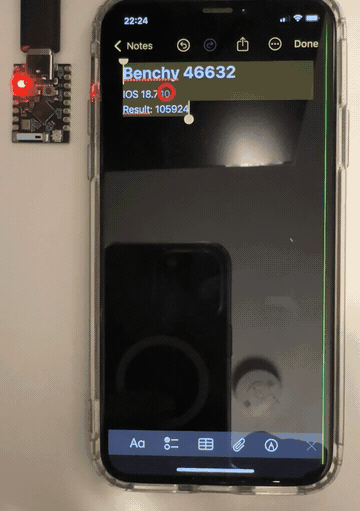
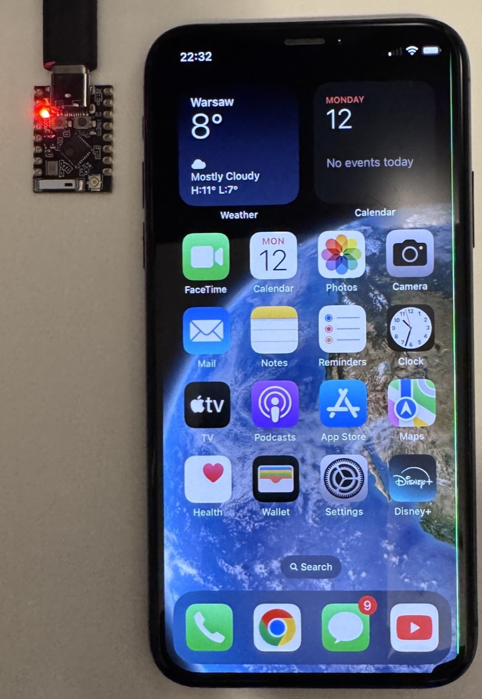

# ihandclaw

> **Proof of concept.** Works end to end on one reference setup; expect rough edges.

<p align="center">
  
</p>

ihandclaw (Python package `iphone_hand`) lets an AI agent operate a real iPhone through an ESP32 acting as a
Bluetooth keyboard and mouse, while the agent sees screenshots from a mirrored
screen. The host turns agent requests into HID actions and uses visual feedback
to position the pointer. You can build the hardware, compare agents and models
on the Benchy benchmark, experiment with fine-tuned models, and contribute
playbooks that teach agents how to navigate iOS apps. The current reference phone
is an iPhone XS running iOS 18; this is an experimental project, not a universal
iOS automation system.

```text
Claude (MCP / Claude Code) or droidclaw + LM Studio model
                       |
             Python host / daemon HTTP API
                 |                    ^ screenshots / OCR
          USB serial or TCP           |
                 |             UxPlay AirPlay (Linux / macOS)
          ESP32-C3 or C5        or USB capture (macOS prototype)
                 | BLE HID            |
                 +---------------> iPhone
```

Read: the [design contract](docs/SPEC.md) defines the protocol and point coordinates.
The [frame-source guide](docs/frame-sources.md) compares AirPlay, USB, and developer
services; the original Portal+/ADB path also remains available.

## Why ihandclaw

Read: most iPhone automation (XCUITest, WebDriverAgent, Appium) needs a Mac with
Xcode, a signed helper app on the phone and Developer Mode. ihandclaw drives the phone
from the outside, the way a person with a keyboard and mouse would:

- **No Mac.** The host runs headless on Linux (the reference setup is a Linux mini PC);
  firmware builds and flashes there too. macOS is supported, not required.
- **No Xcode, no Apple developer account, no app on the phone.** Nothing is signed,
  sideloaded or installed on the iPhone.
- **No Developer Mode, no jailbreak** in the default AirPlay mode. Phone setup is a
  Bluetooth pairing and Accessibility settings (AssistiveTouch).
- **No cable to the phone.** Input arrives over Bluetooth, the screen over AirPlay
  Screen Mirroring; the board itself can sit on Wi-Fi.
- **Any app, no cooperation needed.** Input is real keyboard/mouse HID and the agent
  sees pixels, so third-party apps and Settings work without an accessibility API.
  Measured: Notes, Calculator, Settings and a third-party marketplace app.
- **A few dollars of hardware.** An ESP32-C3 "super mini" board is enough
  (estimated: a few USD retail).
- **Any model.** Claude through MCP or Claude Code, or local models through droidclaw
  and LM Studio, so screenshots can stay on your network.
- **A benchmark that catches false claims.** The [Benchy](bench/README.md) checks the
  phone's final state itself and reports separately when a model claims a success it
  did not achieve.
- **Develop without hardware.** A fake phone and a [record/replay simulator](replay/README.md)
  implement the same daemon API.

The trade-offs: the agent works from screenshots and OCR, with no accessibility tree
(developer services can add one, at the cost of Developer Mode); you unlock the phone
and start Screen Mirroring yourself; and each action takes seconds, not milliseconds
(measured: roughly 2–12 s per action including verification).

## What you need

<p align="center">
  
  <br><sub>The whole rig: a thumbnail-sized ESP32 board (Bluetooth keyboard + mouse) and the phone.</sub>
</p>

| Part | Options and current evidence |
|---|---|
| BLE board | ESP32-C3, including cheap “super mini” class boards, or ESP32-C5; USB-Serial/JTAG and the reference 4 MB flash layout. Measured (owner): C3 boots and answers `PING chip=esp32c3`; this does not establish sustained BLE/Wi-Fi/OTA reliability. |
| Board connection | Data-capable USB cable for installation and serial control; Wi-Fi TCP is optional after private provisioning. Read: C3 is 2.4 GHz; C5 also supports 5 GHz. |
| Phone | Reference: iPhone XS, iOS 18 (375 × 812 pt). Read: other iPhone sizes are implemented and tested offline only (synthetic frames, fake devices), untested on hardware; the daemon reports the size in `/api/state` and over AirPlay needs `screen_pt` in daemon.toml for Face ID iPhones other than 375 × 812. Each new phone needs one calibration run: [add a phone](CONTRIBUTING.md#add-and-calibrate-a-new-phone). |
| Host | Linux for headless AirPlay, or a logged-in macOS session. Python ≥3.11, uv, and ESP-IDF 6.2 (currently `master`; no release yet) for firmware builds. |
| Screen receiver | UxPlay + GStreamer and the same trusted LAN as the phone; no Portal is required for this path. USB capture instead needs macOS and a phone cable. |
| Agent | Claude through MCP/Claude Code, or droidclaw's iPhone backend with LM Studio. Accounts, model weights and compute are supplied by you. |

Prepare the phone yourself:

1. Pair the board in Settings > Bluetooth, following the
   [firmware installation and pairing guide](firmware/README.md#flash-and-pair-manual-not-performed-here).
2. Enable Settings > Accessibility > Touch > AssistiveTouch. Configure the red
   pointer appearance expected by the detector, with auto-hide off; keep the
   phone unlocked. Read: pointer detection depends on this appearance.
3. Select the US hardware keyboard layout. Turn hardware keyboard autocorrection
   off in Settings > General > Keyboard > Hardware Keyboard. **Measured (owner):**
   Non-English hardware keyboard autocorrect (observed with Polish) garbled typed
   English; HID text input alone does not bypass it.
4. Optionally enable Full Keyboard Access under Accessibility > Keyboards.
   Optionally enable Voice Control's item-number overlay for visual targets.
   Read: neither provides a complete accessibility tree to the agent.

## Start without hardware

From the checkout root:

```sh
uv sync --project host
uv run --project host iphone-hand --fake status
uv run --project host python -m pytest host/tests bench/tests catalog
uv run --project host python -m bench.runner --list
```

Read: fake status, tests and scenario listing do not operate a phone. Firmware
builds and native tests are described in [CONTRIBUTING](CONTRIBUTING.md).

## Linux: headless AirPlay quick start

These setup steps are for an operator preparing their own hardware.

1. Build the matching ESP32 target, install and pair it using the
   [firmware guide](firmware/README.md). Prefer USB serial for the first setup.
2. Follow [Linux deployment](deploy/README.md) to install GStreamer/Avahi and build
   **UxPlay 1.73.6**, including the supplied wrapper. Measured (owner): this version
   worked after an iOS restart where the older packaged version did not.
3. Install the host with OCR; typing through the daemon fails closed without OCR:

   ```sh
   uv sync --project host --extra ocr
   ```

4. Create a private daemon config as documented in the deployment guide, supply a
   generated token, set `bind` to `<daemon-host>` and `link` to `serial:<board-port>`,
   and choose `receiver = "external"`. Install the receiver and daemon user units.
   Enable user linger for operation without a desktop session.
5. On the unlocked phone, select the configured receiver in Control Centre >
   Screen Mirroring. Open the daemon UI at `http://<daemon-host>:8790` using your
   private token. Verify the frame and BLE readiness before authorizing an agent.

Read: a static phone screen sends no new AirPlay frames; receiver connection
state keeps the last frame valid. Restarting the receiver requires selecting it
again on the phone. Restart only the daemon when updating its code.

## macOS quick start

1. Use a logged-in session. Install GStreamer and build UxPlay 1.73.6 using
   [macOS deployment](deploy/macos/README.md); install its wrapper and LaunchAgents.
2. Run `uv sync --project host --extra ocr`. Create the private daemon config with
   a generated token, `link = "serial:<board-port>"`, `receiver = "external"`,
   and `frame_source = "airplay"`. Match the receiver's name and frame directory
   to the launchd assets, replacing their placeholders locally.
3. Start Screen Mirroring on the phone; inspect the daemon frame and BLE status.
   Stop any other backend using this board before starting an agent.

Estimated: the macOS deployment remains a prototype needing hardware validation.
USB capture (`frame_source = "usb"`) is implemented but **untested on hardware**;
it needs extra PyObjC packages, trust and camera permission. Follow the
[USB setup and permission notes](deploy/macos/README.md#usb-capture-frame_source--usb)
before trying it. Developer services are a separate diagnostic path requiring
Developer Mode; AirPlay/HID does not require Developer Mode (read: frame-source guide).

## Your first Benchy run

Benchy asks the agent to calculate `1234 × 56` in Calculator, read the phone's iOS
version in Settings, and leave a new three-line note open. Read: the harness
judges final-screen checkpoints C1–C4 and the structured success claim, including
honesty and false successes. It does not independently prove intermediate app
visits or reject every extra note line. Old notes accumulate; it never deletes them.

Once the daemon is ready and you authorize phone actions, set
`IPHONE_HAND_DAEMON_URL`, `IPHONE_HAND_TOKEN`, and `IOS_VERSION` privately in your
shell. The URL uses `http://<daemon-host>:8790`; IOS_VERSION is the actual version
you read on your phone. Do not put tokens in command arguments or tracked files.
Install/authenticate Claude Code separately, then run from the checkout root:

```sh
uv run --project host python -m bench.runner --scenario 00_benchy \
  --ground-truth "ios_version=$IOS_VERSION" --repeat 3 --model haiku \
  --agent-cmd 'uv run --project host python -m bench.agents.claude_cli'
```

Read: this command operates the phone. [The benchmark guide](bench/README.md)
explains reports, budgets, MCP/phone tools, and the droidclaw + LM Studio adapter.
Share sanitized metrics using [the results format](bench/results/README.md),
not raw `runs/` artifacts. No public performance results are included yet.

## Safety and privacy

The agent must never type a passcode or password or confirm purchases/payments.
The owner unlocks the phone. Sending messages or deleting content requires owner
authorization. Use a test phone/account and harmless content when possible.

Read: the daemon requires a token on every route and refuses to start without
one. Its OCR typing guard refuses recognized secure prompts and fails closed
when OCR is unavailable; it cannot recognize every language or screen. Prompt
rules are not a complete security boundary. The pause switch stops new actions
between reports, but cannot retract HID already queued in firmware.

Read: daemon HTTP and board TCP are plaintext; use a trusted network or an
appropriate private TLS setup. Protect the daemon token and separate board token.
Keep **one board client/backend** active; a new TCP connection replaces the old
client. Never connect another daemon or updater during a benchmark.

Screenshots can include notifications, accounts and identifiers. Runs are
ignored by Git, but still private. Review every contribution: no tokens, IPs,
MACs, hostnames, device serials, personal paths, or screenshots with personal data.
Use placeholders in examples. See [CONTRIBUTING](CONTRIBUTING.md).

## Status and next contributions

| Area | Evidence and limitation |
|---|---|
| Linux AirPlay | Measured (owner): headless receiver path worked on the reference phone; these observations are not guarantees for other networks/devices. |
| C3/C5 firmware | Measured in prior validation: both targets built. C3 boot/PING observed by owner; broader C3 runtime testing remains open. [Port notes](docs/ESP32C3_PORT.md). |
| macOS / USB | Read: backend and deployment assets exist. Estimated: permissions and actual capture reliability need hardware validation. |
| Agents | Read: Claude and droidclaw adapters exist; local model quality must be measured with the harness. |
| Playbooks | Read: schema-validated seeds in [catalog](catalog/README.md); automatic adapter integration is still open. |
| Fine-tuning | Estimated: sanitized, consented traces can support experiments; training pipelines and held-out evaluation are contributor work. |
| OTA | Read: authenticated update/rollback prototype; [OTA report](docs/OTA_FIX.md). Timing targets are estimates unless explicitly measured. |

Contribute playbooks, reproducible Benchy results, adapters, board ports, and
hardware validation via [CONTRIBUTING](CONTRIBUTING.md). Deeper references:
[host API](host/README.md), [firmware](firmware/README.md),
[CI](docs/contributor-ci.md), and [contract](docs/SPEC.md).

**Licence:** [MIT](LICENSE), Copyright (c) 2026 Piotr Godlewski. Contributions are
accepted under the same licence. External tools keep their own licences: UxPlay
(GPLv3) runs as a separate program you install yourself, and the optional
`devservices` extra pulls in pymobiledevice3 (GPL-3.0-or-later); see
[publication notes](docs/publication.md).
