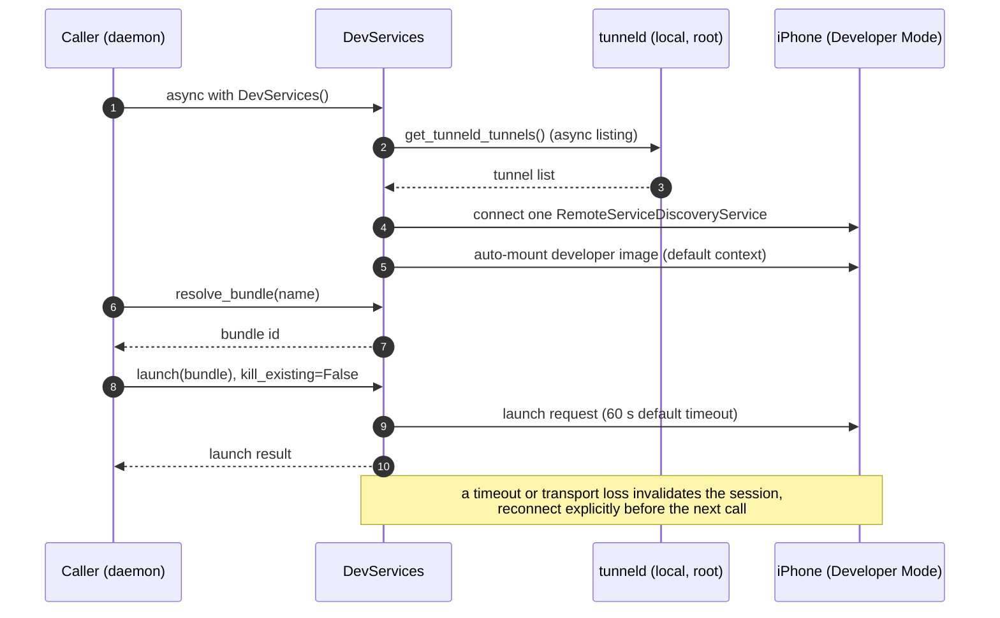

# Developer-services prototype

Read (implementation): `iphone_hand.devservices` is an independent async module for the
structured layer beside `Phone` and OCR. It implements no HTTP/MCP routes and changes no
SPEC, daemon, server, web, or firmware files. The optional dependency is pinned to
`pymobiledevice3==11.26.0`, whose source tag resolves to
[`c0d5f4734fd94c8312223001702d8db39a48a4c3`][upstream]. All source line citations below
refer to that revision, rather than mutable `master`.

Measured (owner-supplied measurement, 2026-10-10; not repeated here): iPhone XS / iOS 18.7.10,
USB, Developer Mode enabled, privileged tunneld running; auto-mount succeeded;
accessibility enumeration returned 24 home-screen and 33 Settings items without geometry;
DVT launched the Settings app. No device was available for this implementation or its tests.

## Setup and CLI

Read (Apple): connect by USB and accept Trust on the phone. The owner performs unlocking
and any passcode entry. Enable Settings → Privacy & Security → Developer Mode, restart,
then confirm enabling it. See [Apple's Developer Mode instructions][developer-mode] and
[device pairing instructions][device-pairing].

Read (implementation): install from `host/`:

```sh
uv sync --extra devservices
```

Read (upstream): an operator starts tunneld using the installed environment's executable
from `host/`, then leaves it running:

```sh
sudo .venv/bin/pymobiledevice3 remote tunneld
```

Read: root is needed for the
classic tunnel's TUN interface; attaching clients run without root. See
[`docs/guides/ios17-tunnels.md:86`][tunnel-setup]. Read (implementation): the operator is responsible
for sudo configuration; this prototype neither configures sudo nor invokes it. Keep tunneld on its default local endpoint.

Read (implementation): commands below access only the selected developer-services
transport. They never construct `Phone`, touch BLE/HID/ADB, start tunneld, or pair:

```sh
uv run --extra devservices iphone-hand dev mount
uv run --extra devservices iphone-hand dev items
uv run --extra devservices iphone-hand dev apps
uv run --extra devservices iphone-hand dev launch com.apple.Preferences
uv run --extra devservices iphone-hand dev launch "Example App"
uv run --extra devservices iphone-hand dev --timeout 120 items
```

Read (implementation): `items` emits parsed JSON; `apps` emits bundle identifiers and
display names; `launch` accepts a bundle or exact case-insensitive display name. Missing
or duplicate names fail instead of guessing. `apps` avoids mounting; `items` and `launch`
mount first. Already-mounted images count as success. No automatic action retries.
With multiple devices, supply a runtime selector through `dev --device` or
`IPHONE_HAND_DEVSERVICES_DEVICE`. Multiple transports for one selected device also fail.
Identifiers and tunnel details never enter this module's error messages.

Read (privacy): captions, spoken descriptions, values, app names and screenshots can
contain personal data. The module adds no logs or persistent cache and suppresses
remote exception messages. Sensitive dataclass fields are omitted from `repr`.
Returned objects and requested CLI JSON still contain the data: consume them in memory,
do not redirect them into fixtures, journal entries, traces, or action logs. Disable
upstream protocol/payload debug logging in any embedding application. All checked-in
test captions and images are synthetic.

Read (upstream): iOS 17/18 uses personalized DDIs. Auto-mount can download an image and
request Apple TSS personalization, so mounting is not guaranteed to work offline. See
[`services/mobile_image_mounter.py:377`][personalized] and
[`services/mobile_image_mounter.py:646`][mount-api]. First mount may need a larger timeout.

## Module contract for the daemon

Read (implementation): imports and constructors are inert. Use one `DevServices` instance
on one event loop; its async operations serialize access. The default context connects
and auto-mounts. `auto_mount=False` permits explicit `mount()` or app-only browsing.

```python
from iphone_hand.devservices import DevServices, OCRBox, match_to_ocr

async def elements_with_geometry(ocr_in_phone_points):
    async with DevServices() as dev:
        items = await dev.list_items()
        boxes = [OCRBox(text, bounds, confidence)
                 for text, bounds, confidence in ocr_in_phone_points]
        return match_to_ocr(items, boxes)

async def launch_app(name):
    async with DevServices() as dev:
        bundle = await dev.resolve_bundle(name)
        return await dev.launch(bundle)
```

Read (implementation): methods also include `list_apps()`, `terminate(bundle_id)`
(SIGKILL, false if not running), `kill(pid)`, `screenshot()`, `focus(uid,
highlight=True)`, `show_visuals(bool)`, `supported_audit_types()` and
`audit_issues(explicit_types)`. Launch sends `kill_existing=False`. Audits are opt-in;
their issue rectangles are returned as upstream strings, without asserting coordinate
units or mapping them to all enumerated elements.

Read (implementation): failures/timeouts/cancellation invalidate the session and request
cleanup; explicitly reconnect before proceeding. Operations default to 60 seconds and
enumeration is capped at 512 elements, failing rather than returning a partial list.
Cleanup gets at most five seconds and requests overlay removal before closing AX/RSD.
Timeouts apply at await boundaries: synchronous upstream DDI work can delay cancellation;
a timed-out action may already have happened. Cleanup is best effort after transport loss.

Read (API choice): the wrapper uses Python APIs throughout. Discovery calls
`get_tunneld_tunnels()` then creates/connects one public `RemoteServiceDiscoveryService`
from the selected listing. The get-by-UDID convenience helper performs blocking HTTP
inside its async body and can open multiple transports; the async listing offloads HTTP
and avoids that path. See [`tunneld/api.py:191`][tunneld-api] and
[`tunneld/api.py:211`][tunneld-list]. Only the default local tunneld is supported here.

Read (implementation): the `launch_app` example above, as a sequence:



## Geometry and AX/DTX research

Read (source): AX uses the `com.apple.accessibility.axAuditDaemon.remoteserver` service
and its RSD shim. The control channel dispatches selector/argument pairs into an event
queue ([`dtx/service.py:558`][dtx-events]); outgoing no-reply calls return `None`
([`dtx/channel.py:76`][dtx-invoke]). The decoded calls relevant to geometry are:

| Read: source call | Read: result / implemented use | Source file:line |
|---|---|---|
| `iter_elements()` | Focus events; caption, speech, identifiers; no frame accessor | [accessibilityaudit.py:627][ax-items], [accessibilityaudit.py:21][ax-fields] |
| `deviceInspectorMoveWithOptions:` | No reply; previous/next/first/last traversal | [accessibilityaudit.py:567][ax-move] |
| `deviceInspectorShowVisuals:` | No reply; requests inspector overlay | [accessibilityaudit.py:471][ax-visuals] |
| `hostInspectorCurrentElementChanged:` | Focus object after traversal; wrapper stops at matching identifier | [accessibilityaudit.py:642][ax-events] |
| `deviceBeginAuditTypes:` | Completion issues; issue-only `ElementRectValue_v1` strings | [accessibilityaudit.py:387][ax-audit], [accessibilityaudit.py:152][ax-rect] |
| `deviceElement:performAction:withValue:` | Activation, entitlement restricted; deliberately not exposed here | [accessibilityaudit.py:508][ax-press] |

Read (bounded finding): the complete 680-line adapter has no element-frame query and no
direct focus-by-identifier setter. This does not prove Apple's private daemon lacks one.
`AXAuditElementAttribute_v1` is a serialized holder, not a demonstrated attribute getter.
No undocumented selector has been invented or sent. `focus()` implements traversal to
the requested identifier and pauses before another advance; prefer the platform identifier
because the upstream UID is explicitly an estimate. [Source: accessibilityaudit.py:45][ax-uid].

Read (public Apple sources): [Accessibility Inspector documentation][apple-inspection]
shows a green outline on the focused element and navigation in accessibility order.
[Auditing documentation][apple-audits] describes highlighting issue elements.
UIKit exposes [`accessibilityFrame` in screen coordinates][apple-frame] inside an app;
that property is not a documented external AXAuditDaemon RPC. No public Apple daemon
RPC specification was found in this research. Estimated: the supported visuals toggle
may provide a useful pixel highlight on this device; its visibility, color, persistence
and capture in AirPlay/DVT still need measurement.

Estimated (algorithm): the English caption parser uses the leading comma-separated token
as the label, recognizes roles/states and interaction hints, and preserves unknown suffix
tokens as `value`. It keeps numeric toggle values as strings; it does not assert that
`0` means Off. Commas inside labels/values and localized traits remain ambiguous.
`caption` and `spoken_description` remain available to the caller for interpretation.

Estimated (OCR fallback): `match_to_ocr(items, boxes)` normalizes case, punctuation and
diacritics, fuzzy-matches leading labels, accepts truncation, and merges up to four adjacent
boxes on the same row. Same-row state/value evidence and optional `row_hints={uid: y_pt}`
help choose repeated labels. AX traversal order is not assumed to be screen order.
Each OCR box is used once; near ties reduce confidence. Missing matches return null
geometry and zero confidence. Confidence is a heuristic score, not a calibrated probability.
Inputs/output use `(left, top, right, bottom)` in phone **points**, origin top-left;
the caller converts OCR pixels first. Returned bounds cover text, not a complete control
or a guaranteed safe tap region. Match only contemporaneous OCR and AX snapshots.

Read (DVT source): `Screenshot.get_screenshot()` invokes `takeScreenshot` and returns
image bytes ([`dvt/instruments/screenshot.py:5`][dvt-shot]). The wrapper verifies/decodes
them and returns actual width, height, format and elapsed milliseconds for that call.
Estimated (not a phone measurement): portrait native resolution may be 1125 × 2436 pixels,
from [Apple's iPhone XS display specification][xs-spec]; DVT may scale/rotate it.
Estimated speed: unknown; the source supplies no latency guarantee, and no defensible
milliseconds/FPS estimate is available without a phone. Runtime timing includes capture,
transport and image verification. No DVT speed or resolution result is claimed from tests.
Read: [process_control.py:138][dvt-kill] implements SIGKILL via acknowledged `sendSignal:toPid:`;
[process_control.py:188][dvt-launch] launches bundles and returns a PID;
[installation_proxy.py:442][app-browse] browses app metadata over the RSD shim.

## Wi-Fi instead of USB on iOS 17/18

Read (pymobiledevice3 11.26.0): persistent tunneld enables USB, usbmux, Wi-Fi RemotePairing
and mobdev2 monitors by default ([`tunneld/server.py:180`][tunnel-monitors]). These are two
different Wi-Fi authentication/discovery routes:

| Read: route | Read: one-time steps | Read: iOS / host implications |
|---|---|---|
| Wireless lockdown / `_apple-mobdev2._tcp` | Trust/pair over USB on the intended host; run `pymobiledevice3 lockdown wifi-connections on` while connected | iOS 17.4+ has CoreDeviceProxy; tunneld's mobdev2 monitor discovers already-paired devices and creates TCP tunnels without a RemotePairing record |
| RemotePairing / `_remotepairing._tcp` | Where the USB control service is available, run `pymobiledevice3 lockdown remotepairing --pair` on an already-trusted connection; alternatively `remote pair` for devices offering manual remote pairing | The older iOS 17.0–17.3.1 route; Wi-Fi adverts must match a recent record containing the device's altIRK |

Read (sources): [`cli/lockdown.py:181`][wifi-enable] implements the wireless switch;
[`cli/lockdown.py:231`][usb-remote-pair] implements USB RemotePairing bootstrap;
[`tunneld/server.py:407`][mobdev2-monitor] creates CoreDeviceProxy tunnels;
[`remote/tunnel_service.py:1603`][wifi-pair-match] rejects unmatched/stale records;
[`lockdown.py:1667`][mobdev2-records] checks known lockdown records. Same-network Bonjour
discovery must be reachable. Pair records belong on the host that runs tunneld, outside
the repository; mounting may need repeating after a device restart.

Read (upstream guide): [ios17-tunnels.md:318][wifi-guide] says Apple's Mac usbmux daemon
can discover wireless devices after enabling Wi-Fi connections. Linux's stock usbmuxd
does not offer equivalent network discovery; explicit mobdev2 discovery is needed for
ordinary CLI commands. Tunneld itself already runs the mobdev2 monitor, so this bridge
continues using the same local API once a wireless tunnel appears. iOS 17.0–17.3.1 on
Linux needs the privileged tunneld/RemotePairing path; iOS 17.4/18 supports the faster
lockdown route ([ios17-tunnels.md:50][older-ios], [ios17-tunnels.md:189][transport-guide]).

Read (upstream): `sudo pymobiledevice3 remote start-tunnel -t wifi` explicitly selects
RemotePairing Wi-Fi. For lockdown-based discovery an operator can use
`sudo pymobiledevice3 lockdown start-tunnel --mobdev2`. These manual commands are setup
alternatives, not processes started by this module. The upstream CLI also offers
userspace/no-root tunnels and a macOS native path; neither is used here because the
requested bridge attaches to a persistent tunneld.

Estimated (assessment): Wi-Fi operation is feasible from the pinned source, particularly
the paired mobdev2/CoreDeviceProxy route on iOS 18/Linux. Success on the owner's phone,
discovery after disconnecting USB, behavior while locked/asleep, reconnection after
reboot and latency still need real measurements. A working USB tunnel does not establish
that either Wi-Fi route is working. No Wi-Fi/device traffic was generated during this work.

## Verification and remaining risks

Read (tests): run `uv run --extra devservices pytest` from `host/`. Tests use synthetic
captions/apps/image bytes, fake backend/service objects, and the suite's serial/subprocess
prohibition. The optional pinned-API test imports the real library with synthetic platform
metadata, without opening a device. No screenshot fixtures or real captions were added.

Measured (local, synthetic-only validation): the full suite passed, 168 tests including
25 developer-services tests, with the optional extra installed. CLI `dev --help` succeeded;
`git diff --check` passed. These results do not measure phone behavior or performance.

Estimated (risks): private Apple protocols can change; focus enumeration changes inspector
state and costs one traversal per element; highlight cleanup can fail after disconnection;
audit rectangles cover issues only; UIDs can be unstable/collide; English caption parsing
and OCR association can misidentify controls; app-name localization/duplicates can block
lookup; stale AX events or an intervening UI change can invalidate geometry. The daemon
must apply its own authorization and transient-data handling before invoking actions.

[upstream]: https://github.com/doronz88/pymobiledevice3/tree/c0d5f4734fd94c8312223001702d8db39a48a4c3
[developer-mode]: https://developer.apple.com/documentation/xcode/enabling-developer-mode-on-a-device
[device-pairing]: https://developer.apple.com/documentation/xcode/managing-your-simulated-and-physical-devices-in-device-hub
[tunnel-setup]: https://github.com/doronz88/pymobiledevice3/blob/c0d5f4734fd94c8312223001702d8db39a48a4c3/docs/guides/ios17-tunnels.md#L86
[personalized]: https://github.com/doronz88/pymobiledevice3/blob/c0d5f4734fd94c8312223001702d8db39a48a4c3/pymobiledevice3/services/mobile_image_mounter.py#L377
[mount-api]: https://github.com/doronz88/pymobiledevice3/blob/c0d5f4734fd94c8312223001702d8db39a48a4c3/pymobiledevice3/services/mobile_image_mounter.py#L646
[tunneld-api]: https://github.com/doronz88/pymobiledevice3/blob/c0d5f4734fd94c8312223001702d8db39a48a4c3/pymobiledevice3/tunneld/api.py#L191
[tunneld-list]: https://github.com/doronz88/pymobiledevice3/blob/c0d5f4734fd94c8312223001702d8db39a48a4c3/pymobiledevice3/tunneld/api.py#L211
[dtx-events]: https://github.com/doronz88/pymobiledevice3/blob/c0d5f4734fd94c8312223001702d8db39a48a4c3/pymobiledevice3/dtx/service.py#L558
[dtx-invoke]: https://github.com/doronz88/pymobiledevice3/blob/c0d5f4734fd94c8312223001702d8db39a48a4c3/pymobiledevice3/dtx/channel.py#L76
[ax-items]: https://github.com/doronz88/pymobiledevice3/blob/c0d5f4734fd94c8312223001702d8db39a48a4c3/pymobiledevice3/services/accessibilityaudit.py#L627
[ax-fields]: https://github.com/doronz88/pymobiledevice3/blob/c0d5f4734fd94c8312223001702d8db39a48a4c3/pymobiledevice3/services/accessibilityaudit.py#L21
[ax-move]: https://github.com/doronz88/pymobiledevice3/blob/c0d5f4734fd94c8312223001702d8db39a48a4c3/pymobiledevice3/services/accessibilityaudit.py#L567
[ax-visuals]: https://github.com/doronz88/pymobiledevice3/blob/c0d5f4734fd94c8312223001702d8db39a48a4c3/pymobiledevice3/services/accessibilityaudit.py#L471
[ax-events]: https://github.com/doronz88/pymobiledevice3/blob/c0d5f4734fd94c8312223001702d8db39a48a4c3/pymobiledevice3/services/accessibilityaudit.py#L642
[ax-audit]: https://github.com/doronz88/pymobiledevice3/blob/c0d5f4734fd94c8312223001702d8db39a48a4c3/pymobiledevice3/services/accessibilityaudit.py#L387
[ax-rect]: https://github.com/doronz88/pymobiledevice3/blob/c0d5f4734fd94c8312223001702d8db39a48a4c3/pymobiledevice3/services/accessibilityaudit.py#L152
[ax-press]: https://github.com/doronz88/pymobiledevice3/blob/c0d5f4734fd94c8312223001702d8db39a48a4c3/pymobiledevice3/services/accessibilityaudit.py#L508
[ax-uid]: https://github.com/doronz88/pymobiledevice3/blob/c0d5f4734fd94c8312223001702d8db39a48a4c3/pymobiledevice3/services/accessibilityaudit.py#L45
[apple-inspection]: https://developer.apple.com/documentation/accessibility/inspecting-the-accessibility-of-screens
[apple-audits]: https://developer.apple.com/documentation/accessibility/performing-accessibility-audits-for-your-app
[apple-frame]: https://developer.apple.com/documentation/uikit/uiaccessibilityelement/accessibilityframe
[dvt-shot]: https://github.com/doronz88/pymobiledevice3/blob/c0d5f4734fd94c8312223001702d8db39a48a4c3/pymobiledevice3/services/dvt/instruments/screenshot.py#L5
[xs-spec]: https://support.apple.com/en-us/111881
[dvt-kill]: https://github.com/doronz88/pymobiledevice3/blob/c0d5f4734fd94c8312223001702d8db39a48a4c3/pymobiledevice3/services/dvt/instruments/process_control.py#L138
[dvt-launch]: https://github.com/doronz88/pymobiledevice3/blob/c0d5f4734fd94c8312223001702d8db39a48a4c3/pymobiledevice3/services/dvt/instruments/process_control.py#L188
[app-browse]: https://github.com/doronz88/pymobiledevice3/blob/c0d5f4734fd94c8312223001702d8db39a48a4c3/pymobiledevice3/services/installation_proxy.py#L442
[tunnel-monitors]: https://github.com/doronz88/pymobiledevice3/blob/c0d5f4734fd94c8312223001702d8db39a48a4c3/pymobiledevice3/tunneld/server.py#L180
[wifi-enable]: https://github.com/doronz88/pymobiledevice3/blob/c0d5f4734fd94c8312223001702d8db39a48a4c3/pymobiledevice3/cli/lockdown.py#L181
[usb-remote-pair]: https://github.com/doronz88/pymobiledevice3/blob/c0d5f4734fd94c8312223001702d8db39a48a4c3/pymobiledevice3/cli/lockdown.py#L231
[mobdev2-monitor]: https://github.com/doronz88/pymobiledevice3/blob/c0d5f4734fd94c8312223001702d8db39a48a4c3/pymobiledevice3/tunneld/server.py#L407
[wifi-pair-match]: https://github.com/doronz88/pymobiledevice3/blob/c0d5f4734fd94c8312223001702d8db39a48a4c3/pymobiledevice3/remote/tunnel_service.py#L1603
[mobdev2-records]: https://github.com/doronz88/pymobiledevice3/blob/c0d5f4734fd94c8312223001702d8db39a48a4c3/pymobiledevice3/lockdown.py#L1667
[wifi-guide]: https://github.com/doronz88/pymobiledevice3/blob/c0d5f4734fd94c8312223001702d8db39a48a4c3/docs/guides/ios17-tunnels.md#L318
[older-ios]: https://github.com/doronz88/pymobiledevice3/blob/c0d5f4734fd94c8312223001702d8db39a48a4c3/docs/guides/ios17-tunnels.md#L50
[transport-guide]: https://github.com/doronz88/pymobiledevice3/blob/c0d5f4734fd94c8312223001702d8db39a48a4c3/docs/guides/ios17-tunnels.md#L189
