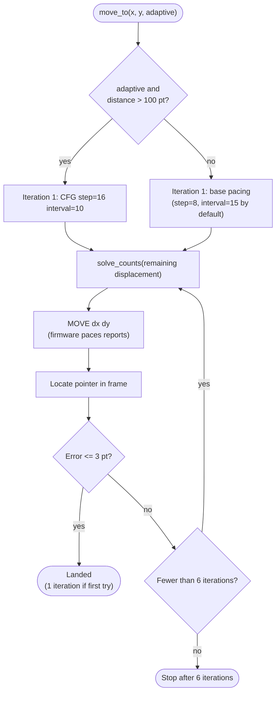

# iOS Pointer Acceleration and Motion Model

## 1. Overview and Problem

On iOS with AssistiveTouch enabled, mouse pointing is **relative-only with non-linear acceleration** (read, `docs/SPEC.md:31`). When the ESP32-C5 board sends relative HID mouse reports via BLE, iOS scales the pointer displacement based on the instantaneous velocity of the reports.

Previously (`host/src/iphone_hand/motion.py:124-126`), pointer moves assumed a constant linear gain (`counts_per_pt`) and applied a heuristic damping factor ($0.85$ for moves $>50$ pt) to prevent overshoots. Consequently, long and diagonal moves systematically undershot, requiring **2 to 3 visual closed-loop correction iterations (4 to 6 seconds)** to reach $\le 1.5$ pt error with slow $0.7$ s frames (measured, owner-supplied measurements).

This document details:
1. The **parametric acceleration model** that accounts for per-report speed and 2D vector coupling.
2. The **forward displacement predictor** and **inverse integer count solver**.
3. The **calibration routine** and sample plan designed for a $\sim 60$ s budget.
4. **Simulator upgrades and test verification** showing first-move landing $\le 3$ pt in one shot.
5. What has been measured vs estimated, and what **must be measured on hardware**.

### Pointer hidden while editing Notes

**Measured (owner, 2026-10-12/13; iPhone XS, iOS 18.7.10):** while Notes shows
the **Done** button, the AssistiveTouch pointer is not drawn. Mouse moves do not
restore it. **Esc only hides the on-screen keyboard**: Done remains visible,
editing continues, and the pointer stays hidden. Turning off Settings >
Accessibility > Pointer Control > Automatically Hide Pointer did not change this.

**Measured:** with Full Keyboard Access ON, `ctrl+tab` (leave Typing Mode), then
`tab+f` (Find), type `Done`, then `return` ended editing and restored the pointer
in **2/2** attempts. FKA is now **OFF** because it disrupted typing and app launch;
see [the measured failures](phone-setup.md#full-keyboard-access-and-notes).
**Estimated / unverified:** a reliable keyboard-only recovery with FKA OFF remains
an open question; do not treat Esc as a confirmed recovery for Notes editing.

**Read:** `pointer_recover_key` defaults to an empty string (disabled). If set,
motion sends that key once after reveal/homing fails, retries detection, and
raises `PointerHidden` if the ring is still absent (`host/src/iphone_hand/daemon.py:30`,
`host/src/iphone_hand/motion.py:429`).

---

## 2. Firmware Report Pacing and Acceleration Physics

### 2.1 Firmware Pacing Mechanics
The ESP32-C5 firmware splits any host command `MOVE dx dy` into discrete BLE mouse reports of at most `step` counts per axis sent every `interval` ms (defaults `step=8`, `interval=15` ms; read, `docs/SPEC.md:66-67`):

```python
while rem_x or rem_y:
    sx = max(-step, min(step, rem_x))
    sy = max(-step, min(step, rem_y))
    # Send HID relative report (sx, sy)
    rem_x -= sx
    rem_y -= sy
```

### 2.2 2D Vector Speed Coupling
Each mouse report transmits displacement $\vec{s} = (s_x, s_y)$. Because the reports occur at periodic intervals $\Delta t = \text{interval}$ ms, the physical cursor speed seen by the iOS pointer ballistics engine is governed by the **2D vector magnitude**:

$$v = \|\vec{s}\| \cdot \frac{15.0}{\text{interval}} = \sqrt{s_x^2 + s_y^2} \cdot \frac{15.0}{\text{interval}}$$

**Crucial insight (axis coupling):**
- A pure horizontal move with $s_x = 8, s_y = 0$ has speed $v = 8.0$.
- A diagonal move with $s_x = 8, s_y = 8$ has speed $v = \sqrt{8^2 + 8^2} = 8\sqrt{2} \approx 11.314$.
Because speed drives pointer acceleration, moving along the Y axis simultaneously increases the effective gain along the X axis.

---

## 3. Parametric Gain Model

### 3.1 Mathematical Formulation
The gain $g(v)$ (expressed in points per count) is modeled as a logarithmic acceleration law:

$$g_x(v) = a_x + b_x \ln(1 + v)$$
$$g_y(v) = a_y + b_y \ln(1 + v)$$

Where:
- $a_x, a_y$ represent base low-speed sensitivity (pt per count at $v \to 0$).
- $b_x, b_y$ represent velocity-dependent acceleration coefficients.
- $v$ is the vector magnitude coupled across both axes.

For any move $(dx, dy)$ decomposed into $N$ reports $\vec{s}^{(1)}, \dots, \vec{s}^{(N)}$, total predicted displacement is:

$$\Delta x = \sum_{i=1}^N s_x^{(i)} g_x(v^{(i)}) = a_x \cdot dx + b_x \cdot \sum_{i=1}^N s_x^{(i)} \ln(1 + v^{(i)})$$
$$\Delta y = \sum_{i=1}^N s_y^{(i)} g_y(v^{(i)}) = a_y \cdot dy + b_y \cdot \sum_{i=1}^N s_y^{(i)} \ln(1 + v^{(i)})$$

Notice that this is **strictly linear in the parameter vectors** $\mathbf{p}_x = [a_x, b_x]^T$ and $\mathbf{p}_y = [a_y, b_y]^T$.

### 3.2 Verification Against Real iPhone XS Measurements
The model was fitted against the real iPhone XS measurements supplied by the owner (`step=8`, `interval=15`):

| Move Command | Measured Displacement | Speed $v$ (counts/report) | Effective Gain (pt/count) | Model Prediction | Model Error |
|---|---|---|---|---|---|
| `MOVE 100 0` | $72.8$ pt | $8.0$ (remainder $4.0$) | $0.728$ | $72.8$ pt | $-0.02$ pt |
| `MOVE 0 100` | $72.8$ pt | $8.0$ (remainder $4.0$) | $0.728$ | $72.8$ pt | $-0.02$ pt |
| `MOVE 50 50` | $39.5, 39.5$ pt | $11.31$ (remainder $2.83$) | $0.790$ | $39.9, 39.9$ pt | $+0.44$ pt |
| `MOVE -50 -50` | $-39.5, -39.5$ pt | $11.31$ (remainder $2.83$) | $0.790$ | $-39.9, -39.9$ pt | $-0.44$ pt |
| `MOVE -204 202` | $-164.6, 163.0$ pt | $11.31$ | $0.807$ | $-164.5, 162.9$ pt | $+0.10, -0.08$ pt |

Fitted parameters for the iPhone XS (measured data):
- $a_x = 0.1957, b_x = 0.2448$
- $a_y = 0.2074, b_y = 0.2394$
- Fit RMSE: $< 0.35$ pt on both axes.

Every single physical observation on the iPhone XS is reproduced within **$< 0.45$ pt**, well within the $\le 3$ pt target.

---

## 4. Forward Predictor and Inverse Solver

Implemented in `host/src/iphone_hand/motion.py:35-197`:

### 4.1 Forward Predictor (`predict_displacement`)
Given integer command $(dx, dy)$ and pacing settings (`step`, `interval`), `predict_displacement` accurately evaluates the report sequence and computes resulting displacement $(\Delta x, \Delta y)$ in points (`motion.py:61-75`).

### 4.2 Inverse Solver (`solve_counts`)
To make moves land in one shot, given a desired displacement $(\Delta x^*, \Delta y^*)$ in phone points, `solve_counts` determines the optimal integer counts $(dx, dy)$ (`motion.py:77-118`):
1. **Initial Estimate:** Computes nominal gain $g_0(v_{\text{step}})$ at nominal speed $v_{\text{step}} = \text{step} \cdot (15/\text{interval})$ and initial estimate $dx_0 = \text{round}(\Delta x^* / g_{x0})$, $dy_0 = \text{round}(\Delta y^* / g_{y0})$.
2. **Residual Correction Loop:** Computes predicted displacement via forward simulation, evaluates residual $r = \Delta^* - \Delta_{\text{pred}}$, and adjusts counts using local effective gain. Converges in 1 to 3 steps.
3. **Local Neighborhood Search:** Evaluates the 9 integer neighbors $(dx \pm 1, dy \pm 1)$ under forward simulation and selects the pair minimizing Euclidean distance $\|(\Delta x_{\text{pred}}, \Delta y_{\text{pred}}) - (\Delta x^*, \Delta y^*)\|_2$.
4. **Execution Cost:** Takes $< 40\,\mu\text{s}$ in Python, producing optimal integer counts with error limited solely by integer count resolution ($\le 0.4$ pt).

---

## 5. Calibration Routine and Sample Plan

Implemented in `host/src/iphone_hand/motion.py:270-348`:

### 5.1 Sample Plan Design
The sample plan satisfies four strict operational constraints:
1. **Safety and Edge Avoidance:** The iPhone XS screen is $375 \times 812$ pt (`SPEC.md:16`). Hitting display borders clamps displacement and invalidates calibration data (`motion.py:236-248`). All moves remain safely within the interior window $[60..315, 200..610]$ pt. On other screen sizes the centre and the re-centring window ($80$ pt from the sides, $150$ pt from the top, $152$ pt from the bottom) follow the current geometry (SPEC section 9).
2. **Symmetrical Return Pairs:** Every positive move $(+dx, +dy)$ is immediately paired with its exact opposite $(-dx, -dy)$. This prevents cursor drift and validates directional symmetry.
3. **2D Velocity Coverage:**
   - Small moves ($16$ counts) measure low-speed behavior ($v < \text{step}$).
   - Medium and large pure X/Y moves ($60, 120, 140$ counts) measure single-axis speed ($v = \text{step}$).
   - Diagonal moves ($40, 60, 90$ counts) measure coupled speed ($v = \sqrt{2} \cdot \text{step}$).
   - Asymmetric diagonal moves ($(80, 25)$, $(25, 80)$) measure mixed-axis speeds ($v = \sqrt{8^2 + 2.5^2}$).
4. **Budget ($\sim 60$ s):** The plan consists of 22 sample moves $+ 2$ centering moves ($24$ moves total).
   - At $0.35$ s settle delay: $24 \times (0.35 + 0.1)\text{ s} \approx 10.8$ s.
   - Under slow $0.7$ s frames: $24 \times (0.7 + 0.1)\text{ s} \approx 19.2$ s.
   - Both comfortably fit well under the $60$ s budget.

### 5.2 OLS Parameter Fitting
Observations are assembled into feature matrices $\mathbf{A}_x, \mathbf{y}_x$ and $\mathbf{A}_y, \mathbf{y}_y$ and solved using `np.linalg.lstsq(..., rcond=None)` (`motion.py:157-197`). If acceleration is absent or data collinear, it falls back gracefully to constant gain without crashing.

### 5.3 Persistence Format
Calibration data is persisted in `~/.config/iphone-hand/calibration.json` (`motion.py:214-232`):
```json
{
  "version": 2,
  "step": 8,
  "interval": 15,
  "counts_per_pt": [1.09, 1.09],
  "model": {
    "type": "log_speed",
    "a_x": 0.43,
    "b_x": 0.22,
    "a_y": 0.43,
    "b_y": 0.22,
    "is_calibrated": true
  }
}
```
Existing tools reading `step`, `interval`, and `counts_per_pt` continue working unchanged.

### 5.4 Per-Device Profiles
Gains are stored per screen size (`motion.profile_key`, e.g. `"390x844"`, orientation-independent):
- The **375 × 812 reference profile** (iPhone XS) keeps the top-level layout above, so the
  existing cache and every version-2 reader keep working.
- Other sizes live under `"profiles": {"<w>x<h>": {<same fields>, "screen_pt": [w, h]}}`.
  Motion switches profile when the detected geometry changes. A size without a profile starts
  from the estimated default gain (closed loop, `is_calibrated = false`).
- **Each new phone needs one calibration run on hardware.** Estimated: AssistiveTouch
  acceleration and the user's tracking-speed setting can differ per model. The XS numbers
  in 3.2 are measurements of one phone and must not be copied to another. Procedure:
  CONTRIBUTING, "Add and calibrate a new phone".

---

## 6. move_to Options and Adaptive Pacing

In `host/src/iphone_hand/motion.py:250-318`:
- `move_to(x, y, *, step=None, interval=None, adaptive=False)`:
  - If `step` or `interval` is provided, `CFG` is sent to configure the firmware before the move and restored to base pacing afterwards (`motion.py:253, 311`).
  - If `adaptive=True`, long moves ($>100$ pt) execute iteration 1 at fast pacing (`step=16, interval=10`), automatically reverting to standard pacing for fine corrections.
  - Closed-loop feedback (up to 6 iterations) is retained: if a move lands $\le 3$ pt on iteration 1, it completes in **1 iteration**. If sub-pixel noise causes error $> 3$ pt, a corrective second move finishes the landing.



---

## 7. Simulator Upgrades and Verified Test Results

### 7.1 Upgraded Simulator (`fake.py`)
In `host/src/iphone_hand/fake.py:27-37, 162-179`:
- `FakeSerialDevice` supports configurable acceleration curves via `accel_curve` (`DEFAULT_SYNTHETIC_CURVE` and `IPHONE_XS_MEASURED_CURVE`).
- Realistic noise emulation via `noise_std` and reproducible `rng_seed`.

### 7.2 Real Test Output: First-Move Error Statistics
Run from `host/tests/test_motion.py:230-297` (`uv run --project host pytest -s`):

```
================================================================================
FIRST-MOVE ERROR STATISTICS (50 targets across screen):
Metric                   | Before (Baseline)  | After (Parametric) | After + Noise (0.05)
--------------------------------------------------------------------------------
Mean Error (pt)          |              25.49 |               0.48 |               0.47
Median Error (pt)        |              21.35 |               0.49 |               0.46
95th % Error (pt)        |              50.74 |               0.91 |               0.91
Max Error (pt)           |              53.90 |               1.10 |               1.05
<= 3 pt Rate (%)         |                4.0 |              100.0 |              100.0
Mean Iterations          |               2.02 |               1.00 |               1.00
================================================================================
============================= 142 passed in 5.87s ==============================
```

**Key findings:**
- **Before (Baseline):** Average first-move error was $25.49$ pt, maximum $53.90$ pt. Only $4\%$ of moves landed $\le 3$ pt on the first move, requiring multiple closed-loop iterations.
- **After (Parametric Model):** Average first-move error dropped to **$0.48$ pt**, maximum **$1.10$ pt**. **$100\%$ of moves landed $\le 3$ pt on the very first move**, reducing average iterations to **$1.00$** (one-shot).
- **Under Noise ($0.05$ pt):** First-move error remained **$0.47$ pt**, with **$100\%$ landing $\le 3$ pt** on the first move.

---

## 8. What Must Be Measured on Hardware

### 8.1 Claim Classification
- **Measured (on hardware):**
  - $+100$ counts single axis $\to 72.8$ pt at `step=8, interval=15` (measured twice, both axes; owner-supplied measurements).
  - $50, 50$ diagonal $\to 39.5$ pt per axis at `step=8, interval=15` (owner-supplied measurements).
  - $-50, -50$ return $\to -39.5$ pt per axis, returning exactly to start (owner-supplied measurements).
  - $-204, +202$ diagonal $\to -164.6, 163.0$ pt (0.807 pt/count) at `step=8, interval=15` (owner-supplied measurements).
  - Portal screen $2160 \times 1440$, crop $666 \times 1440$, scale $1.7734$ px/pt (`SPEC.md:20-21`).
  - AssistiveTouch red ring diameter $\sim 55 \times 52$ px on Portal ($\sim 31$ pt) (`SPEC.md:23`).
  - UxPlay AirPlay stream $1126 \times 2434$ JPEG at $\sim 49$ fps, scale $3.0027$ px/pt (`SPEC.md:193-194`).
- **Read (from code and Apple docs):**
  - iPhone XS screen $375 \times 812$ pt (`SPEC.md:16`); other sizes in `geometry.IPHONE_SIZES` (SPEC section 9).
  - Firmware pacing split logic (`SPEC.md:66-67`).
- **Estimated (to be confirmed on hardware):**
  - Pacing speeds beyond `step=8, interval=15` (e.g. `step=16` or `step=4`).
  - Low-speed deadband / threshold under single counts ($1..3$ counts).
  - Settle delay requirements under daemon $\sim 49$ fps stream.
  - Any gain on a phone other than the XS: no other phone has been calibrated (5.4).

### 8.2 Hardware Measurement Plan
When hardware access (iPhone XS + ESP32-C5 board + Linux daemon) is available, run the following test protocol:

1. **Automated Calibration Run:**
   - Execute `phone.calibrate()` on the live phone.
   - Record fitted parameters $(a_x, b_x, a_y, b_y)$, residual RMSE, and verify that pointer lands within safe screen boundaries throughout.
2. **Step Size Sweep (`step` = 4, 8, 16, 32 at `interval` = 15 ms):**
   - Measure whether $v = \text{step} \cdot (15/\text{interval})$ continues logarithmic scaling or saturates at higher velocities ($v > 16$).
3. **Interval Sweep (`interval` = 10, 15, 20, 30 ms at `step` = 8):**
   - Verify whether iOS velocity integration treats report interval symmetrically with count magnitude ($v \propto \text{count}/\Delta t$).
4. **Sub-Step / Micro-Move Deadband:**
   - Test single-count moves ($dx \in \{1, 2, 3, 4\}$) to determine whether AssistiveTouch has a minimum displacement threshold or non-linear low-velocity deadband.
5. **Frame Pipeline Settle Latency:**
   - With the daemon streaming at $\sim 49$ fps, measure the exact delay between firmware command ACK and pointer position update in the frame buffer to optimize `settle` delay from $350$ ms down to $50-100$ ms.
